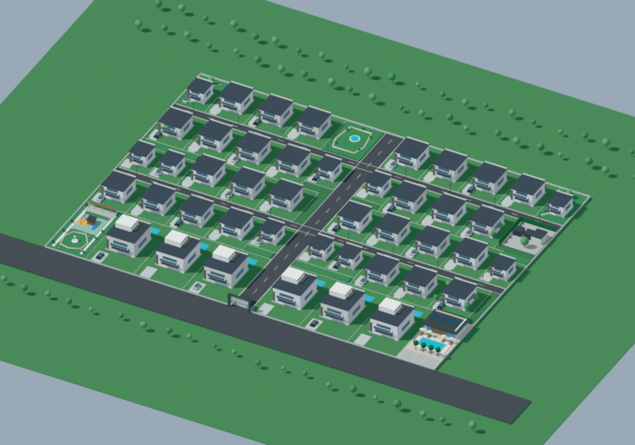

# Luxury Estate — 30,000 m² PBR 3D Asset Pack

**A portable, editable spatial 3D masterplan and integration starter for a conceptual 44-plot luxury estate.**

## What's inside

| Asset | File | Role |
| --- | --- | --- |
| Portable 3D model | **models/luxury-estate-masterplan.glb** | glTF 2.0 for websites, games, AR/VR and model viewers |
| Editable scene | **models/luxury-estate-masterplan.blend.xz** | Losslessly compressed original Blender 5.2 scene (recover editable .blend with extraction script) |
| Verified 3D screenshot | **renders/real-3d-aerial-preview.png** | Rendered from the actual Blender 3D project (not an AI concept image) |
| Dimensioned 2D plan | **renders/dimensioned-plot-plan.svg** | Measured, plot-labelled diagram derived from plot coordinates |
| Plot coordinates | **data/plot_schedule.csv** / **data/plots.json** | Per-parcel origin, width, depth and area in local metres |
| Program & provenance | **data/land_program.json** / **data/asset_checksums.json** | Areas, design assumptions and source integrity |
| Live browser viewer | **index.html**, **web/**, **package.json** | Vite + Three.js orbit/zoom GLB viewer |
| Integration notes | **docs/INTEGRATION.md** | Unity, Unreal, Godot, Three.js and Blender |
| Validator | **scripts/validate_assets.py** | Check file signatures and land-area/overlap invariants |

## Quick start: interactive 3D viewer

Requirements: Node.js 20+.

~~~bash
npm install
npm run dev
~~~

Open the local URL displayed by Vite. Rotate, pan, zoom, reset the view, and show/hide lot markers and amenity objects. Run **npm run build** for a static **dist/** bundle suitable for Cloudflare Pages or any static host.

For direct engine imports, use **models/luxury-estate-masterplan.glb**. For detailed editing, run **python scripts/extract_blender_source.py** first, then open the restored **models/luxury-estate-masterplan.blend** in Blender.

## Spatial program — exactly 30,000 m²

- 6 front premium plots × 1,000 m² = 6,000 m²
- 28 residential plots × 500 m² = 14,000 m²
- 10 residential plots × 300 m² = 3,000 m²
- **Total residential: 23,000 m² across 44 plots**
- **Reserved common land: 7,000 m²**, conceptually 3,400 m² of roads/circulation and 3,600 m² of amenities, gardens and utilities.

The 3D revision includes the grand entrance/security, clubhouse and pool, playground, fitness area, pocket parks, parking, utility zones and drainage details. Decorative houses, vehicles, planting and amenity furnishings are illustrative.

## Measured coordinates

The design **assumes** a 200 m × 150 m rectangular site. Local Blender coordinates use X/Y on the ground and Z vertically, in metres. Plot positions are in **data/plot_schedule.csv**. The GLB exporter applies standard glTF axis conversion; check engine coordinate conventions before placement.

Run:

~~~bash
python scripts/validate_assets.py
python scripts/extract_blender_source.py
~~~

## Important limitations

- This is a **design/concept asset pack**, not a survey, regulatory approval, civil drawing, construction BIM, or land title document. Site shape, plot setbacks, drainage routes, approvals, turning dimensions and amenities must be professionally checked before any real-world use.
- To keep GitHub uploads light, the lossless .blend is stored as .blend.xz (263 KB instead of 5.2 MB). After extraction it is byte-for-byte identical to the original. Blender has procedural PBR-style materials. Portable GLB uses glTF-compatible simplified material representations; it does **not** guarantee identical procedural shading, high-resolution PBR texture maps, or photorealistic output in every engine.
- The aerial PNG shows the real editable 3D scene. Separate AI marketing artwork, if any, is **not** a measured representation and is not included here.

## Source and rights

Editable original project: [Higgsfield 3D Jutsu / estate revision 3](https://higgsfield.ai/3d-jutsu/cdc073b7-90dd-4965-b9b9-a530bbef0861).

Prepared for a private project repository; no public asset redistribution licence is granted. Project owner can choose a licence before publishing.

See **docs/INTEGRATION.md** for engine-specific steps.
